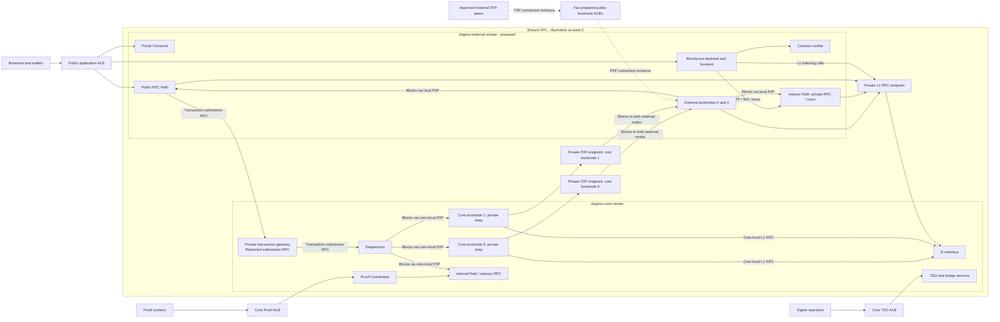
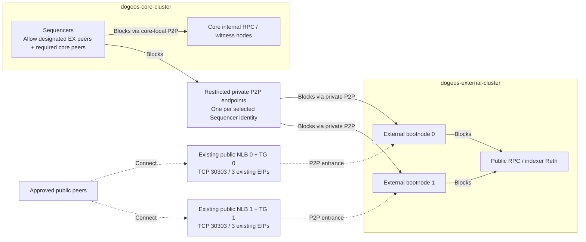
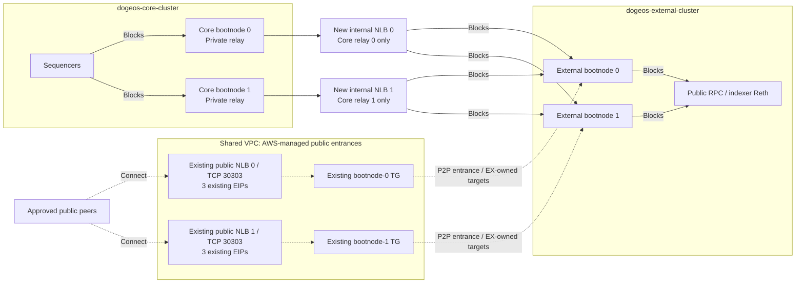
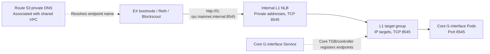

# Core and external-service cluster design

Status: reference proposal; not an implemented SDK deployment mode.
Design reviewed: 2026-10-16 JST. Moved to SDK documentation: 2026-10-17 JST.

This document proposes separating public access and explorer workloads from core
DogeOS services. It does not establish that the second cluster, private endpoints,
workload bindings or network policies exist. Cluster and resource names below
are illustrative. Keep actual account IDs, VPC/subnet IDs, IP allocations, ARNs
and command receipts in the operator deployment repository. No live cloud or
cluster inventory was refreshed to write this design.

## Recommendation and boundaries

Use `dogeos-core-cluster` as the illustrative core cluster and
`dogeos-external-cluster` for public bootnodes, Portal, public RPC and Blockscout.
Use the same AWS account, region and VPC initially. The three-AZ address examples
use us-west-2a, us-west-2c and us-west-2d. Use separate worker groups, security groups,
Kubernetes administration and workload IAM identities for each cluster.

Two P2P options remain under consideration; neither has been selected for deployment:

- **Option A: two external bootnodes, one relay layer.** Only these designated
  external nodes peer privately with Sequencers. No dedicated core relays are
  required. Other external workloads cannot connect to Sequencer P2P ports.
- **Option B: two core relays plus two external bootnodes, two relay layers.**
  Each external bootnode peers with both private core relays. No external node
  can connect directly to Sequencer P2P ports.

Option A is the initial evaluation candidate for a small, controlled
peer set. Choose B if forbidding all external-to-Sequencer P2P sessions is a hard
requirement, or rehearsal shows a need to isolate downstream sync load further.
This is an engineering recommendation, not an implementation decision.
Both options can reuse a pre-provisioned public NLB pair and its six EIPs for
external bootnodes in this three-AZ design. Neither exposes Sequencer P2P publicly or requires public worker IPs.
The transaction gateway belongs in the core cluster in both options; external
callers cannot access Sequencer RPC directly.

The objective is to isolate public traffic, indexing load, upgrades and workload
failures from sequencing and bridge operations. Two clusters in one VPC still
share network infrastructure and account/regional dependencies; this is not full
network or disaster-recovery isolation. The second cluster adds control-plane,
node, controller, observability and private-endpoint operating cost.

The external cluster joins the existing chain. It must not generate a different
genesis, deploy another set of chain contracts or repeat bridge funding. Share
reviewed chain identity, genesis and protocol artifacts across both deployments.

## Workload placement

| Workload | Placement | Dependency or reason |
| --- | --- | --- |
| Sequencer instances and signing permissions | Core | Preserve the reviewed sequencing topology and isolate signing authority. |
| l1-interface and core Dogecoin RPC dependencies | Core | Supply L1 data to core services and restricted private readers. |
| TSO, Withdrawal Processor and L1/DA submission | Core | Keep bridge and submission operations together. |
| Proof Coordinator and internal witness RPC | Core | Avoid making proof preparation depend on explorer availability. |
| Internal Reth RPC used by core services | Core | Retain even after Blockscout moves; do not redirect core consumers to the external indexer. |
| Core bootnode 0 and core bootnode 1 | Core, Option B only | Private non-sequencing relays between Sequencers and external bootnodes. Not required by A. |
| External bootnode 0 and external bootnode 1 | External, both options | Public P2P entry points with private L1 reads; upstreams are Sequencers in A or both core relays in B. |
| Portal / frontend | External | Independent public release and scaling lifecycle. |
| Blockscout backend, frontend and verifier | External | Isolate explorer traffic and indexing. |
| Blockscout-specific Reth RPC | External | Dedicated historical queries, receipts, logs and tracing. |
| Public wallet RPC / WebSocket Reth | External | Prefer a separate node from the indexer to isolate methods and load. |
| Blockscout database | Private managed database, or dedicated external-cluster service | Separate database/user and capacity budget; a separate instance provides stronger performance isolation. |
| dstack and worker orchestration | Unresolved | Review trust, storage and ingress dependencies separately. |

## Application topology (Option B illustrated)

Solid P2P arrows show the intended downstream block propagation direction.
They do not depict every protocol message or imply one-way P2P sessions.
Dashed public P2P edges show connection entrances; HTTP/RPC edges carry explicit
labels. Private endpoints are proposed additions. Public load balancers are AWS
resources outside either Kubernetes control plane.
This overview illustrates B. In A, omit the core relays and replace their private
P2P endpoints with restricted, identity-specific Sequencer P2P endpoints. All
other application placement and RPC boundaries remain the same. The two P2P
options are drawn separately below.



The transaction gateway must select the valid sequencing destination for the
actual runtime topology. A sequencer count of two does not establish active/standby
semantics or justify round-robin transaction forwarding. Core services must retain
their own internal RPC and peer paths independently of the external cluster.
The grouped external-bootnode box represents two independent nodes, each peering
with both core relays. The private transaction gateway remains a distinct RPC
path to Sequencers; it does not grant direct external-to-Sequencer P2P access.

## P2P topology alternatives

The diagrams below show block dissemination from Sequencers to downstream nodes.
There is no inbound P2P arrow into Sequencers in this view. This is a diagram of
the intended block flow, not evidence that a Sequencer receives no P2P messages:
peer sessions still exchange protocol traffic. Dashed edges describe public
connection entrances, not an inbound block path to the Sequencer. Source access
rules and peer relationships remain as specified for each option.

### Option A: two external bootnodes, one relay layer

Each public NLB and its existing target group serves exactly one external
bootnode identity. The two external bootnodes are the only external peers
permitted to reach the reviewed Sequencer P2P endpoints. The endpoint set must
match the actual Sequencer topology; never balance unrelated node identities
behind one enode address. Endpoint implementation and private addressing remain
to be selected, so A does not imply that private P2P ingress needs no preparation.



The private endpoint is transport infrastructure, not an extra chain relay.
Sequencers establish P2P sessions with the external bootnodes in this option.
Enforce network and peer-identity restrictions together; do not allow the entire
external cluster or infer an exclusive allowlist merely from configured trusted
peers. Retain core-local peers and RPC independently of the external cluster.

### Option B: two core relays and two external bootnodes

The following view expands the four bootnodes and their independent entrances.
Each public NLB has three existing EIPs, one per enabled AZ. Its target group
selects only its corresponding external bootnode identity. Both external nodes
connect to both core relays. Solid arrows show blocks propagating downstream;
the external bootnodes initiate the cross-cluster P2P sessions.



Both private core relays are required for redundancy if this layer is chosen.
They must have separate identities, volumes and worker placement. Do not add
direct EX-to-Sequencer fallback, as that would bypass B's defining boundary.

### Comparison and selection criteria

| Dimension | Option A | Option B |
| --- | --- | --- |
| Dedicated bootnode/relay count | Two external | Two external plus two core |
| Public Sequencer P2P entrance | None | None |
| Direct Sequencer peers on the external side | Only the two designated EX bootnodes | None; Sequencers peer with core relays |
| Sequencer downstream peer count | Can be limited to two EX bootnodes | Can be limited to two core relays; not inherently fewer than A |
| Additional operational work | Secure identity-specific private Sequencer paths | Two stateful core relays, their private endpoints, storage and monitoring |
| Synchronization path | One relay layer | Two relay layers; added propagation/recovery dependency |
| Isolation benefit | Public peers terminate at EX bootnodes | Public-facing nodes have no direct P2P session with Sequencers |
| Relay failure | One EX node can remain; rehearse recovery and upstream pressure | Either core relay can remain; losing both interrupts external synchronization |
| Suitable starting condition | Small controlled EX peer set; restricted private Sequencer peering accepted | No EX-to-Sequencer P2P permitted, or demonstrated need for another load-isolation layer |

Additional relays do not automatically improve overall availability and are not
protocol firewalls. Shared client defects and VPC dependencies remain. Any benefit
from absorbing historical sync requests must be demonstrated with the selected
client release. The SDK bootnode example describes a stateful non-sequencing node
(requests: 2 CPU / 8 GiB; volume: 1000 Gi per node), not a lightweight TCP proxy.
These are template defaults, not measured minimum requirements or deployed sizes.

Industry references support separating public networking from block production,
but do not establish a requirement for two relay layers in DogeOS:

- [Oasis Sentry architecture](https://docs.oasis.io/node/run-your-node/sentry-node/)
  places private validators behind public sentries and includes a two-sentry
  example. A's EX pair can serve a similar architectural role; client behavior differs.
- [Arbitrum feed relays](https://docs.arbitrum.io/run-a-node/run-feed-relay)
  provide redundant upstream feed distribution for node fleets. These are feed
  relays, not the stateful DogeOS bootnode role.
- [OP Stack P2P specification](https://specs.optimism.io/protocol/rollup-node-p2p.html)
  describes block gossip and peer validation, without prescribing this fixed
  four-node layout. Its protocol and recovery guarantees must not be assumed for DogeOS.

### Public address reuse (both options)

If two public NLBs already exist across three AZs, their six EIPs can remain
mapped to those NLBs when external-cluster Pods become the targets. EIPs are not
attached to a Kubernetes cluster. Record actual allocations in the deployment
inventory; the mapping below describes ownership only.

| Public NLB / intended node | us-west-2a | us-west-2c | us-west-2d |
| --- | --- | --- | --- |
| Bootnode 0 / external bootnode 0 | NLB 0 EIP in AZ a | NLB 0 EIP in AZ c | NLB 0 EIP in AZ d |
| Bootnode 1 / external bootnode 1 | NLB 1 EIP in AZ a | NLB 1 EIP in AZ c | NLB 1 EIP in AZ d |

Retain the six allocations, NLB subnet mappings, listeners and target groups.
The external cluster's controller registers the external bootnode Pods through
TargetGroupBindings. Under B, core relays use separate private target groups owned
by the core controller. Under A, any private Sequencer target groups also belong
to the core controller. Private NLBs use private addresses and do not consume these EIPs.
The existing public resource names can remain unchanged; their `bootnode-0/1`
indices refer to the external pair in this design.

## Network layout

### VPC, subnets and routing

- Reuse the existing VPC initially. Prefer dedicated private worker subnets for
  the external cluster where capacity permits. Reusing private subnets requires
  explicit Pod/node IP-capacity planning.
- Select one public load balancer subnet per enabled AZ; this example uses
  us-west-2a, us-west-2c and us-west-2d. Keep actual subnet IDs in the deployment
  inventory. External bootnodes must run in AZs enabled on their NLBs. Retain
  NLB cross-zone balancing.
- Keep worker nodes private. Public services should enter through their designated
  load balancers, without requiring public worker IP addresses.
- Plan distinct Kubernetes Service CIDRs for both clusters, avoiding overlaps
  with VPC and connected-network ranges. Check VPC CNI Pod address consumption,
  node scaling and any custom networking before allocating subnets.
- Select load balancer subnets explicitly to avoid unintended auto-discovery by
  the two controllers.
- Cluster API access is a separate management choice. Prefer private access where
  the operator's management network supports it.

### Private service discovery

Kubernetes Service DNS and ClusterIP addresses are local to a cluster. An external
Pod calling `http://l1-interface:8545` does not automatically reach the core
cluster, even in the same VPC. Do not configure cross-cluster consumers with
changing Pod IPs or assume remote `*.svc.cluster.local` names resolve.

Provide stable private endpoints, then private DNS aliases when the private zone
is chosen. AWS-generated internal load balancer names can be used before aliases
are assigned. Domains in this design are conceptual; no production names are set.

| Endpoint | Proposed mechanism | Constraint |
| --- | --- | --- |
| L1 RPC | Internal NLB, optionally fronting an RPC gateway | Restrict callers and methods; a TCP NLB does not filter JSON-RPC methods. |
| P2P, Option A | Restricted private endpoint for each selected Sequencer identity | Permit only the designated EX bootnodes and reviewed core peers; no public exposure. |
| P2P, Option B | Separate private endpoint for each core relay identity; internal NLBs are the initial option | Expose relays, not Sequencers. Never balance unrelated identities behind one enode endpoint. |
| Transaction submission | Private RPC gateway behind an internal endpoint | Expose only required submission methods and route to the valid sequencer. |

These private endpoints are additional infrastructure, not the existing
internet-facing bootnode NLBs, which remain assigned to external bootnodes.
Do not repurpose those public NLBs as core private endpoints. In B, use one
dedicated internal NLB per core relay as the initial option. In A, choose stable
private routing to each selected Sequencer identity. The final private load
balancer count depends on that choice and L1 RPC/transaction gateway placement.
HTTP endpoints may share a private load balancer with explicit routing; P2P still
needs identity-preserving routing. Cross-cluster callers must use private routes
rather than public NLB DNS names and an assumption that same-VPC traffic is private.

### Example: external workloads calling core L1 RPC

Use `l1-rpc.mainnet.internal` as an illustrative private DNS name. It has not been
created or selected as the final production name. Associate the chosen Route 53
private hosted zone with the shared VPC and configure the name as an alias to the
internal L1 NLB. Verify name resolution from Pods in both clusters.



The Service identifies the Pod endpoints for target registration; it is not an
extra ClusterIP hop between an IP target group and the Pods. Illustrative
external Reth Helm values are:

```yaml
reth:
  l1Url: "http://l1-rpc.mainnet.internal:8545"
```

The corresponding Blockscout environment setting is:

```text
INDEXER_SCROLL_L1_RPC=http://l1-rpc.mainnet.internal:8545
```

Core-local callers can retain `http://l1-interface:8545` in the appropriate
namespace. The example uses HTTP over private routing; it does not provide TLS.
If method filtering or TLS/authentication is required, place an RPC gateway in
the path and update the target, URL and listener configuration accordingly.
Allow only approved external callers at the private entrance and allow backend
traffic/health checks from the NLB security group to the actual target security
groups. Verify the source identity used by the selected CNI/security-group setup.

Private HTTP DNS names do not establish that the selected client's enode parser
supports DNS names. Verify that behavior separately before finalizing trusted
P2P peers; use a supported, stable private address for each upstream identity.

### Network preparation before workload installation

| Item | Owner / scope | Required preparation |
| --- | --- | --- |
| External EKS networking | External cluster in the shared VPC | Choose private worker subnets, distinct Service CIDR, IP capacity, API access and explicit kubecontext. |
| Controller and target ownership | Separate controller per cluster | Prepare external IAM/OIDC and TGB support; assign public bootnode TGs to EX and private core TGs to core. |
| Public bootnode entrances | Existing AWS NLBs and six EIPs | Preserve resources; inspect current targets/owners, then configure frontend and backend rules for the external pair. |
| P2P entrances, Option A | Restricted private Sequencer endpoints | One identity per endpoint; only designated EX bootnodes may establish cross-cluster P2P sessions. |
| P2P entrances, Option B | Two new internal NLBs and two private TGs, initial option | One core relay identity per endpoint; private TCP 30303 and health-check paths. |
| Core L1 entrance | New private endpoint and core-owned targets | Internal NLB/gateway, private DNS and restricted TCP 8545 backend access. |
| Transaction submission | Separate restricted private RPC path | Resolve valid Sequencer routing and allowed methods before enabling wallet writes. |
| DNS and verification | Shared VPC private zone and both clusters | Verify Pod DNS, private routing and the selected A/B peer boundary; deny direct EX-to-Sequencer RPC in both. |

This same-VPC proposal does not require VPC peering between the clusters. Routing
alone is insufficient: security groups, network policies and endpoint/controller
ownership must also match. Public domains and ACM certificates can remain pending
while these private paths are prepared and tested.

### Communication matrix

Ports describe intended backend ports; TLS gateway listeners must be finalized
with the implementation. Return traffic on an established P2P connection does not
require unrestricted new connections in the reverse direction.

| Initiator | Destination | Protocol / port | Purpose and boundary |
| --- | --- | --- | --- |
| Approved public peers | Bootnode NLBs | TCP 30303 | Public peering; approved source CIDRs are still pending. |
| Designated external bootnodes, A only | Reviewed private Sequencer P2P endpoints | TCP 30303, subject to endpoint mapping | Restricted direct peering; no other EX workload is permitted. |
| Each external bootnode, B only | Both core relay private P2P endpoints | TCP 30303, subject to endpoint mapping | Private synchronization through redundant relays; no direct Sequencer fallback. |
| Core relays, B only | Sequencers | TCP 30303 | Core-local peering. |
| Core relays, B only | Core l1-interface Service | HTTP 8545 | Core-local L1 reads. |
| External indexer/public Reth | External bootnodes | TCP 30303 | Local peering; no direct Sequencer P2P in either option. |
| External bootnodes and Reth | Private L1 RPC | HTTP 8545 backend; private TLS gateway optional | Required L1 reads and node initialization. |
| Blockscout backend | Private L1 RPC | HTTP 8545 backend | Current Scroll-mode generator sets an L1 indexer endpoint; verify enabled indexing paths. |
| Public RPC Reth | Private submission gateway | HTTP/TLS; sequencer RPC backend usually 8545 | Forward raw transactions to the correct sequencer. |
| Blockscout backend | Indexer Reth | HTTP 8545 / WS 8546 | Historical queries, tracing and head subscription; no public ALB route to this node. |
| Browsers and wallets | Public ALB | HTTPS / WSS 443 | Portal, explorer and restricted wallet RPC. Browsers cannot access VPC-only addresses. |
| Public ALB | External Services | Service ports | Current bindings use port 80 for frontend/API and 8545/8546 for RPC; verify rendered targets. |
| Blockscout backend | Database | PostgreSQL 5432 with configured TLS | Separate credentials and permissions from core workloads. |
| External Reth/supporting components | Configured DA/archive sources | Provider-specific, commonly HTTPS 443 | Audit sync-mode dependencies; use VPC endpoints/private routes where supported. |
| Monitoring | Assigned metrics endpoints | Configured metrics ports | Explicit scrape access, not broad admin/RPC exposure. |

Cross-cluster application paths are intended to stay private. Image registries,
public chain providers and other third-party dependencies are separate egress
paths; this design does not claim every outbound request can remain inside the VPC.

## Node and application configuration

### Bootnodes

The current `l2-reth` bootnode role is a non-sequencing chain node with persistent
data and an L1 URL, not merely a discovery daemon. Keep sequencing disabled and
signer type `none`. Preserve stable node identities, configure trusted private
upstream peers, and distribute identical reviewed genesis/chain settings.

- In B only, core bootnode 0/1 remain in the core cluster, connect to Sequencers and expose
  only private P2P entrances. They do not own the prepared public NLB target groups.
- External bootnode 0/1 run in the external cluster. In A, they peer with reviewed
  Sequencer endpoints; in B, each peers with both core relays. Each uses its public NLB for
  approved external peers. Keep local external RPC/indexer peering on local paths.
- All bootnodes (two in A, four in B) have distinct node keys, Secret references and persistent
  volumes. Reusing an index of 0 or 1 in separate clusters must not reuse the same
  Secret Manager key path or node identity. Use explicit core/external naming.
- In B, place the two core relays on different worker nodes, preferably different AZs;
  also spread the external pair. Reserve resources for relay traffic. Keep the
  witness RPC separate from the relay role to avoid coupling proof queries to
  downstream sync pressure.
- In B, the additional relay hop may add propagation delay and introduces a dependency.
  Monitor Sequencer, core-relay and external-node head lag separately. Do not
  configure automatic direct-to-Sequencer fallback in the external cluster.

Validate initial sync, head propagation, restart and catch-up against the chosen
image digest. P2P versus optional remote-block-source requirements depend on the
selected client configuration. Retain core-to-core peers so external bootnodes
are never the sole communication path between core nodes.

### Blockscout-specific Reth

Use a dedicated non-sequencing Reth/rollup-node with its own persistent volume and
resource budget. Plan historical state retention for full indexing and reindexing;
archive configuration is the recommended starting point, subject to the actual
DogeOS client version. Enable required tracing only privately and bound concurrency.

The current generator sets Blockscout HTTP and trace URLs to `http://l2-rpc:8545`
and WS to `ws://l2-rpc:8546`. A local external-cluster Service named `l2-rpc` can
preserve these references. `INDEXER_SCROLL_L1_RPC` must instead reach the private
core L1 endpoint. Existing values select the `geth` Blockscout variant: verify
tracing compatibility before changing it merely because the client is Reth.

### Public RPC and transaction forwarding

Prefer a separate public RPC node from the indexer node. Limit public methods and
request/concurrency budgets; keep admin, tracing and witness interfaces private.
Sharing initially is a capacity tradeoff requiring method filtering and indexer
limits, with weaker isolation than the recommended steady state.

The chart supports `reth.rpc.sequencerUrl`, mapped to `--network.sequencer-url`.
The inspected rollup-node code uses that URL for raw transaction forwarding.
Point it at the reviewed private submission endpoint and validate the selected
release. Successful block synchronization alone does not prove wallet writes work.

### Frontend and database

Configure browser-facing RPC and explorer URLs as public HTTPS/WSS endpoints.
Inventory every frontend API dependency before moving its release. Keep the
verifier and database privately reachable. Separate database capacity from core
services when performance isolation matters; a separate user/schema on the same
instance isolates permissions but not resource consumption.

## Resource reuse and controller ownership

| Resource role / illustrative name | Proposed consumer | Treatment |
| --- | --- | --- |
| `dogeos-bootnode-0-nlb` and TCP 30303 target group | External bootnode 0 | Reuse in the same VPC; external cluster owns target registration. |
| `dogeos-bootnode-1-nlb` and TCP 30303 target group | External bootnode 1 | Same reuse and identity boundary. |
| Six bootnode EIPs | External bootnodes' existing public NLB mappings | Preserve allocations and mappings. |
| Private Sequencer P2P entrances, A only | Sequencers | New restricted private routes/endpoints; allow only designated EX peers and reviewed core peers. |
| Core relay private P2P entrances, B only | Core bootnodes 0 and 1 | New private endpoints and separate target groups; do not register core Pods in public target groups. |
| `dogeos-tso-alb` / HTTP 3000 target group | Core TSO | Retain or prepare separately; configure HTTPS listeners/rules. |
| `dogeos-proof-alb` / HTTP 7788 target group | Core Proof Coordinator | Verify workload timeout needs; configure HTTPS listeners/rules. |
| Shared public application ALB | External public applications | Reuse or provision in the shared VPC; configure host routing, certificates and target groups. |
| Private cross-cluster endpoints | Core services consumed by external nodes | Additional infrastructure to design and provision. |

Keep exact ARNs and provisioning status in the operator deployment inventory
and configuration rather than duplicating them throughout this proposal.

Check actual target ownership before deploying; this proposal does not assert
that target groups are empty or unbound. The intended public bootnode target-group
owner is the external cluster, including when resources were originally prepared
for the core cluster. The TSO and Proof ALBs remain assigned to the core cluster.

Each cluster needs its own controller and IAM/OIDC binding. Assign each target
group to one cluster's TargetGroupBinding reconciler. By default, controllers can
deregister targets absent from their own cluster; do not let both manage one
group during a move. Shared multi-cluster target groups require explicit design
and are not needed for this steady state. Account for finalizer/deregistration
behavior before transferring ownership during any cutover.

Reuse assumes compatible Pod routing, backend security-group rules and enabled
AZs. A separate-VPC external cluster would require reevaluating controller checks,
target registration and routing; do not assume the same-VPC design applies unchanged.

## Security and failure boundaries

- Create separate controller/workload IAM roles. New IRSA trust must name the new
  OIDC provider and exact ServiceAccounts; the old trust is not automatically reusable.
- External services receive only their node keys, database credentials and required
  read access. Do not copy sequencer signing permissions or all core Secrets.
- In A, permit only designated EX bootnodes and reviewed core peers at Sequencer
  P2P endpoints. In B, permit only reviewed core peers and deny all direct EX P2P.
  Neither option exposes Sequencer P2P publicly. Core relays in B have no public entrance.
- In both options, place the transaction gateway in core, restrict its submission
  methods and deny direct EX-to-Sequencer RPC. The gateway is a separate RPC path.
- Restrict cross-cluster traffic by caller and endpoint. Enforce JSON-RPC method
  boundaries in gateways/applications in addition to network security groups.
- Verify actual NetworkPolicy enforcement. Namespace/label selectors in one cluster
  do not select remote Pods; use the real endpoint path and observed source addresses.
- Give bootnodes scheduling/capacity protection from heavy indexing inside the
  external cluster, otherwise Blockscout may still starve public peering.

| Failure | Intended behavior or limitation |
| --- | --- |
| External cluster outage | Public explorer/RPC/peering may fail; core internal work must not depend on this cluster. |
| Core L1 private endpoint outage | External initialization or L1 processing may stall; verify runtime recovery behavior. |
| One external bootnode fails, A or B | The other retains its upstream path; test downstream recovery and isolate reconnect/catch-up pressure. |
| Private Sequencer P2P path fails, A | External propagation may stall; verify alternate reviewed upstreams where supported and recovery without public exposure. |
| One core relay fails, B | Both external bootnodes retain their other core peer; verify catch-up without direct Sequencer fallback. |
| Both core relays or their private paths fail, B | External heads may lag while core operation continues; restore relay paths and alert on chain lag. |
| Submission gateway outage | Wallet writes can fail while reads continue; monitor separately. |
| Indexer overload | Dedicated RPC/storage/scheduling contain impact; a single indexer still has an availability limitation. |
| Shared VPC/AZ dependency outage | Both clusters may be affected; two control planes do not remove common infrastructure dependencies. |

## Deployment configuration and implementation sequence

Current generated values contain same-cluster Service references. Changing only
kubecontext is insufficient. Do not assume the current deployment workflow can
express two clusters without adaptation.

Maintain one chain artifact set and separate core/external installation scopes,
values, Secret access and explicit Kubernetes contexts. Review endpoint overrides
and resource ownership before rendering. Ensure generation does not restore local-only
addresses or install core services in the external cluster. A single
spec's `bootnodeCount: 2` does not define placement across clusters. Define two
external bootnodes in both options and two additional core relays only in B,
with unique key/Secret ownership. Keep
public P2P disabled for the core scope; configure `mode: existing` public NLB
bindings only for external bootnodes. This document does not change the spec.

1. Select A or B explicitly, then agree on placement, VPC/subnet allocation, capacity, private DNS ownership and
   access policies. Identify required private endpoints and their owners.
2. Audit selected CLI/chart/client versions for endpoint overrides, node identity,
   forwarding and genesis compatibility. Define separate render/install scopes
   and implement any missing configuration support.
3. Create the external cluster, controllers, IAM identities and storage support.
   Confirm private routing, IP capacity and network-policy enforcement.
4. In A, prepare restricted identity-specific private Sequencer P2P paths.
   In B, deploy or retain two core relays, verify their Sequencer peering and
   prepare separate private relay endpoints. Prepare private L1/submission
   entrances and restrictive access rules in both options.
5. Deploy the two external bootnodes and external RPC nodes using shared chain
   artifacts and distinct keys. Configure A's reviewed Sequencer peers or B's
   two core relay peers. Test L1 reads, synchronization and the selected peer
   boundary before assigning public target ownership.
6. Bind existing bootnode target groups to the external cluster, one owner each.
   Validate target health and P2P connections from approved peers.
7. Install Blockscout, verifier and database integration. Test historical indexing
   against its dedicated node without loading the core witness RPC.
8. Prepare Public ALB/ACM/DNS and public application bindings. Complete separate
   core TSO/Proof HTTPS integration and configure frontend public URLs.
9. Run the acceptance checks below before declaring the split operational.

If workloads already exist, use a tested migration and cutover: preserve volumes
and identities, avoid simultaneously running one node key in two places, and
account for EBS AZ constraints or snapshot/restore. Retain the old deployment until
acceptance. Rollback must restore routes, target ownership and Secret access as
well as workloads. If applications are not yet deployed, install directly into
the intended cluster rather than inventing a migration for nonexistent workloads.

## Acceptance criteria

- Both clusters' nodes report the same chain ID and genesis hash. Compare block
  hashes at identical heights and confirm acceptable ongoing head lag.
- Demonstrate initial sync, restart and historical catch-up through the selected
  path: Sequencer -> EX bootnode -> RPC/indexer in A, with the additional core
  relay hop in B. Confirm distinct identities for every bootnode.
- In A, verify only the designated EX bootnodes can peer with Sequencers; test
  restart, catch-up and connection pressure while monitoring Sequencer block
  production and resources. Confirm other EX workloads are denied.
- In B, confirm each EX bootnode connects to both core relays. Stop one relay
  during rehearsal and verify continued propagation without Sequencer fallback.
  Verify all direct EX-to-Sequencer P2P is denied and core relays have no public entrance.
- In both options, test loss of one EX bootnode and verify transaction forwarding
  through the core gateway separately; deny direct EX-to-Sequencer RPC.
- Verify private cross-cluster traffic with connection/flow evidence, not DNS names
  alone. Test required L1 reads and denial from unrelated workloads.
- Verify any DA/archive access without unnecessary write permissions.
- Submit an authorized test transaction through public RPC, observe sequencing
  and receipt, and distinguish submission from inclusion/finality.
- Confirm historical and live Blockscout indexing, tracing and restart recovery
  without excessive load on core services.
- Confirm public entrances exclude admin, tracing, witness and core-only methods.
- Confirm one controller per target group and correct registration on Pod replacement.
- In the rehearsal environment, disrupt external services and verify core operation,
  alerting and recovery independently of frontend availability.
- Validate database backups, volume recovery, DNS/TLS and resource budgets.

## Open decisions

| Decision | Proposed starting point |
| --- | --- |
| VPC placement | Same VPC; separate private worker subnets where feasible. |
| P2P option | A is the initial evaluation candidate; choose B for the stricter peer boundary or measured isolation need. Neither selected yet. |
| Public/indexer RPC | Separate nodes; one indexer initially is not an HA design. |
| Private endpoints | L1 RPC and core submission gateway in both; private Sequencer P2P in A or per-relay P2P in B. |
| Private transport security | Choose TLS/application authentication where applicable; retain P2P identity validation. |
| Relay capacity and AZ placement | Two EX bootnodes in both; two additional core relays in B. Separate nodes/AZs and resource budgets. |
| Sequencer transaction routing | Core gateway selects the valid runtime destination; no round-robin assumption. P2P endpoints preserve peer identities. |
| Database/storage | Dedicated indexer volume and DB permissions; prefer separate database capacity. |
| Domains, certificates, access CIDRs | Pending; placeholders are not approved production inputs. |
| Public ALB / dstack | Public ALB serves external applications; dstack needs its own placement decision. |
| CLI support | Audit/adapt endpoint and render/install ownership before deployment. |

## Source basis

These implementation points were inspected for the original 2026-10-16 proposal.
Recheck the selected revisions before implementation; these are not pinned runtime
versions or live deployment evidence:

- `scroll-sdk/examples/values/l2-reth-bootnode-production.yaml`: non-sequencing
  bootnode configuration, persistent data, signer and L1 URL.
- `scroll-sdk/charts/l2-reth/templates/_helpers.tpl`: trusted peers, L1 URL and
  sequencer URL command-line mapping.
- `dogeos-rollup-node/crates/network/src/manager.rs`: received block announcement
  relay path; runtime initial-sync and catch-up behavior still require validation.
- `dogeos-rollup-node/crates/node/src/add_ons/mod.rs`: raw transaction forwarding.
- `scroll-sdk-cli/src/utils/values-generator.ts`: Blockscout HTTP/trace/WS and L1 URLs.
- `scroll-sdk/examples/values/l2-reth-rpc-production.yaml`: internal witness RPC.
- [AWS EKS VPC/subnet guidance](https://docs.aws.amazon.com/eks/latest/best-practices/subnets.html).
- [TargetGroupBinding ownership](https://kubernetes-sigs.github.io/aws-load-balancer-controller/latest/guide/targetgroupbinding/targetgroupbinding/).
- [Route 53 private hosted zones](https://docs.aws.amazon.com/Route53/latest/DeveloperGuide/hosted-zones-private.html).
- [Blockscout JSON-RPC/tracing requirements](https://docs.blockscout.com/setup/requirements/node-tracing-json-rpc-requirements).
